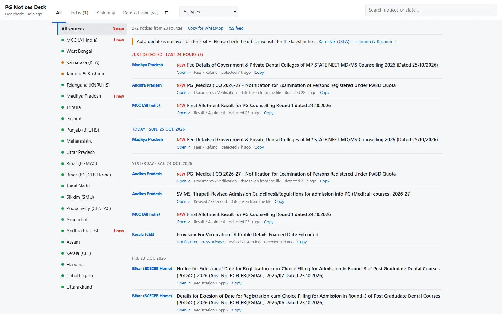

# PG Notices Desk

A live desk of **NEET PG counselling notices** from MCC and the state counselling authorities, in one searchable page. It updates itself every 10 minutes, with no admin panel and no database.

**Live:** https://mahesh-kumar99.github.io/PG_notifications/  &nbsp;|&nbsp;  **RSS:** [feed.xml](https://mahesh-kumar99.github.io/PG_notifications/feed.xml)



## Why it exists

PG counselling notices are scattered over more than twenty official sites, and missing one (a revised schedule, an extended deadline, a new round) can cost a candidate a seat. This desk collects them verbatim, shows what changed in the last 24 hours, and links straight to the official notice.

## Features

- **23 official sources** monitored in parallel: MCC plus 22 state authorities (see [`sources.json`](sources.json))
- Notices are shown **verbatim**: title, link and date, with no rewriting, so nothing is misquoted
- "Just detected" feed for the last 24 hours, filters by state, notice type and date, and free-text search
- RSS feed, plus optional Telegram alerts for new notices
- Handles awkward sources: postback links, JSON APIs, Hindi titles, sites that block datacentre IPs, and dates that only exist inside PDFs

## How it works

```
sources.json ──▶ monitor.py ──▶ notices.json ──▶ pg_notices.html (+ feed.xml)
 (23 sources)    fetch, parse,    diff against      built from template.html
                 de-duplicate     what was seen     and published to GitHub Pages
```

1. [`monitor.py`](monitor.py) fetches every source with `requests` and parses it with BeautifulSoup. Each source declares its own URLs and selectors in `sources.json`.
2. New notices are merged into `notices.json`. Only genuinely new rows are flagged, so the page can show "new in the last 24 hours".
3. [`template.html`](template.html) is rendered into a single static page, and `feed.xml` is generated from the same data.
4. The [`PG notices`](.github/workflows/notices.yml) workflow runs this on a schedule, commits the data, and deploys the page to GitHub Pages. A second [`Watchdog`](.github/workflows/watchdog.yml) workflow restarts the job if the data goes stale for 45 minutes or more.

## Run it locally

```bash
pip install -r requirements.txt
python monitor.py              # check all sources
python monitor.py MCC          # check only some source ids
python monitor.py --html-only  # rebuild the page from notices.json
```

Open the generated `pg_notices.html` in a browser.

Optional Telegram alerts: set `TG_BOT_TOKEN` and `TG_CHAT_ID` as GitHub Actions secrets, or put `{"bot_token": "...", "chat_id": "..."}` in a local `config.json` (git-ignored).

## Known limitations

- Two sources (Karnataka KEA and Jammu & Kashmir) block requests from GitHub's servers, so they show a link to the official site instead of scraped notices.
- If an official site is redesigned, only that source reports an error; the rest keep updating.

## Stack

Python · requests · BeautifulSoup · GitHub Actions · GitHub Pages

---

Built by [Mahesh Kumar](https://mahesh-dev-zeta.vercel.app), frontend developer from Delhi.
